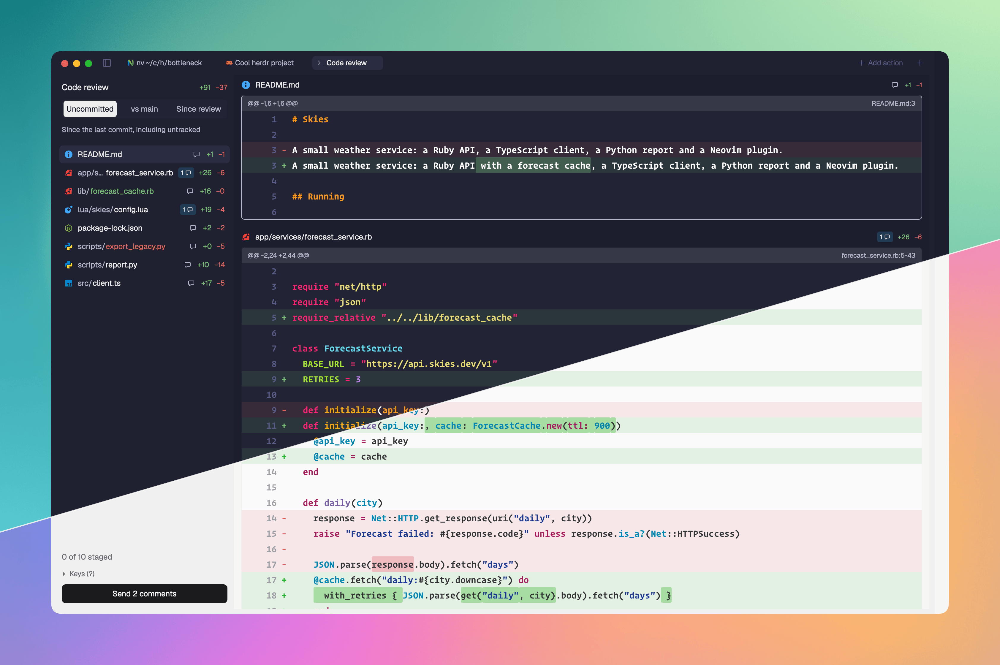

# Bottleneck

Review your agent's code without being the bottleneck. Press `cmd-shift-r` and a Code review tab opens beside your agent, laid out like a GitHub pull request. Comment on any hunk or file and send it all to an agent with the corresponding code. Connect your agents through Bottleneck's MCP server and they answer each comment under the code. They also flag what they're unsure about and rank the files by risk, so you know where to look first. Each round shows only what changed. Stage as you go, then commit, push and open a pull request without leaving the tab.



## What you see

The Code review tab is one mod pane split into two columns. Everything uses `theme()` colors, so it follows light and dark themes.

**Left column, 300px wide, `chrome` background, 1px `border` on its right.** Its text runs 12-14px, to match the layout's own panels:

- Header, 10px padding, 1px `border` underneath:
  - "Code review" in 14px semibold, with the total `+N` in `ansi2` and `−N` in `ansi1` (12px) on the right.
  - A three-segment switch, 28px high, 13px text, on a `background` pill with a 1px `border`: **Uncommitted**, **vs main** and **Since review**. The chosen one is `solid` with `solid_foreground` semibold text, so it's obvious at a glance (`selected` is too close to the pill's own background in some themes); the other is `muted`.
  - One 12px `dim` line saying what the diff covers: "Since the last commit, including untracked", or "Since origin/main, including uncommitted" (it names the base it found), or a note when there's no base to compare with.
- File list toolbar, 32px, 14px in, 1px `border` underneath: "5 files to review" in 12px `muted` on the left; on the right, 24px icon buttons with 14px icons (`ui/path.svg`, a list; `ui/risk.svg`, a warning triangle), the picked one `raised` with `foreground`, the other `muted` with `hover`. Tooltips "Order by path", and "Order by risk" or "Rank by risk" when there's no ranking yet. In risk order, a re-rank button (`ui/rerank.svg`) sits left of them with the tooltip "Re-rank · ranked 3 min ago". Ranking has no key: there are enough already. The order is remembered per Code review tab.
- File list, scrolling, 6px padding. One 30px row per file, 13px text: a 15px file type icon, folder in `muted` then file name, the name colored by what happened to the file (`ansi2` added, `ansi1` and struck through deleted, `foreground` modified), the speech bubble (below), then `+N` / `−N`. The file holding the selected hunk has a `selected` background. In risk order, a 3×16px bar in the risk's color (`ansi1` high, `ansi3` medium, `ansi2` low) leads the row, and its tooltip is the agent's reason.
- Footer, 10px padding, 1px `border` above: the key hints and a 32px button with 13px text.
  - The hints sit under a clickable "▾ Keys" line in 12px `muted`. Collapsed, it reads "▸ Keys (?)" and the hints are hidden; the choice is remembered for every Code review tab (`shared("bottleneck.hintsCollapsed")`), and `?` toggles it too.
  - Expanded, one hint per row, 4px apart: the keys in an 84px column, each its own 20px-high cap (`raised`, 1px `border`, 4px corners, terminal font at 11px), then what it does in 12px `muted`, spelled out: "next / previous hunk", not "hunk". Shift is a cap of its own, `⇧`, and shifted letters show as capitals, so file reads `⇧` `J` `K` and stage file `⇧` `space`. In order: `h` `l` previous / next view, `j` `k` next / previous hunk, `⇧` `J` `K` next / previous file, `c` comment on hunk, `f` comment on file, `x` delete comment, `s` send comments, `space` stage hunk, `⇧` `space` stage file, `d` discard hunk, `⇧` `D` discard file, `⇧` `C` commit, `⇧` `P` push, `z` fold file, `v` mark file viewed, `e` agent explains diff, `a` ask about hunk, `r` reply to agent, `/` search the diff, `n` `⇧N` next / previous match, `+` `-` more / less context. A key list mixing shifted and plain keys gives each shifted one its own cap (`n`, `⇧N`); one that's all shifted shows a single `⇧` first. They're built from the key table, so they always show the keys it binds. With comments it reads "Send 3 comments" in `solid` / `solid_foreground`; without, "No comments yet" in `raised` / `muted`.

**Right column, `canvas` background:**

- **The speech bubble** (`comment.svg`, an outline speech bubble drawn for this mod, tinted with the text color): with no comments on the file, an 18px square holding a 12px icon in `muted`, `hover` background on hover; with comments, a badge on `accent` at alpha `33` (`55` on hover) holding the count at 10px in `foreground` and a 10px icon. Tooltip "Comment on the whole file", or "2 comments · click to comment on the whole file". It counts hunk and file comments together.
- One scrolling list of every file and hunk, in path order, starting 12px down:

  - File header row, 34px: a 16px file type icon, full path (semibold, colored by status like the left list), "clipped" when the file was cut short, the speech bubble, `+N` / `−N`.
  - A file comment sits right under its file's header, before any outdated comment or hunk: a free-standing card 12px in from each side, 6px corners, 1px `border`, `surface` background, a 3px `accent` bar on the left, labelled "File comment · f to edit, x to delete".
- Each hunk is a card 12px in from each side with 12px below it, a 1px `border` rule running across the middle of that gap so one hunk's end is never in doubt (4px and no rule between parts of the same hunk, so they read as one block): 1px border (`muted` when selected, so you can always see which hunk you're on; `border` otherwise. `input` was tried and is too faint in some themes, and `accent` is usually a bright blue that looks loud in screenshots), 6px corners, `background` fill.
  - A 26px `raised` header in 11px `dim`: the `@@ -a,b +c,d @@` line with git's function context after it, and on the right `file.ts:6-10`, the hunk's changed lines in the new file. A hunk split into parts also shows a small `background` tag, "part 2 of 3", before the range.
  - The lines in the terminal's font (`settings().font_family`, else JetBrains Mono) at the size `font_size` sets in `~/.config/herdr-app/bottleneck.json` (8 or more; the file is optional and re-read on every refresh, so an edit shows within seconds), else the terminal's size minus one (`settings().font_size`, 13 if unset, so 12px; never under 10), each row 1.65 times that (20px at 12px), so code reads at the size the person reads it everywhere else. Then a right-aligned line number 3.7 times the size wide in `dim` in `dim`, the `+` / `-` sign, then the text cut off at the pane edge. Added lines get `ansi2` at alpha `1c`, removed lines `ansi1` at alpha `1c`.
  - With `delta` installed, every line, removed ones included, is syntax highlighted in `delta`'s colors (its dark theme on a dark Herdr theme, its light one otherwise, or whatever `delta.syntax-theme` the person's git config names). Where a line was changed rather than added or removed whole, the words that changed get a stronger tint, `ansi2` or `ansi1` at alpha `4d` with 2px corners, like GitHub's word diff. Without `delta`, every line is plain `foreground`.
  - A saved comment sits at the bottom of its hunk's card, as a row of its own: `surface` background, 1px `border` above, a 3px `accent` bar down the left edge, an 11px `dim` label "Comment · c to edit, x to delete", then the text at 13px, wrapped.
- A comment whose hunk has gone shows at the top of its file as a free-standing card with a `dim` bar, labelled "Outdated · path:line".
- **Agent notes** (after `e`): a 26px row at the top of the hunk's card, under its header: `surface` background, 1px `border` below, "Why" in 12px `muted`, then the note in `foreground`, cut off at the edge.
- **Risk callout** (in risk order), like GitHub's markdown callouts: right under the file header, 12px in from each side with 10px below, a 4px bar down the left in the risk's color, 14px in from it a title row (a 16px icon and "High risk", "Medium risk" or "Low risk" in 13px bold, both in the risk's color), then the reason in 13px `foreground`, wrapped in full. High is `ansi1` with `ui/caution.svg` (GitHub's Caution octagon), medium `ansi3` (yellow) with `ui/risk.svg` (the Warning triangle), low `ansi2` with `ui/low.svg` (a tick in a circle). Its height is worked out from the reason's length, like a comment's.
- **Conversations** (with the MCP server), set apart from the code like a GitHub review thread: under its hunk's lines, before any new comment on that hunk, a row with a 1px `border` above, `chrome` background and 10px padding holds a box: 6px corners, 1px `border`, `background` fill. Each message is a row, 12px in and 10px tall padding, 1px `border` between messages: a 24px round `raised` avatar (the agent's program icon, saved with the conversation so it outlives the agent, or `ui/user.svg` for you), then the name in 12px semibold ("You" or the program's name) and "3 min ago" in `muted`, then the text at 13px, wrapped. A 30px `surface` strip closes the box: an 8px dot, `blocked` with "Waiting for Claude Code" while it's the agent's turn, `ansi2` with "Claude Code answered" after; "r reply · x close" on the right, all 12px `muted`. A hunk can have several. One about a whole file, or whose hunk has gone, is a free-standing box at the top of its file with a 28px `raised` bar reading "lines 5-43" or "Whole file" (the file header above already names the file). Once its hunk (or, standing alone, its file) is fully staged it's hidden, as staged code is done with; unstaging brings it back, and `r` on staged code says "Unstage it to see its conversation and reply".
- **Viewed files** swap their file type icon for a bold "✓" in `ansi2` (green), the same size as the icon, in the left list, their diff header and the sticky header; dimming alone (they also dim to 50% in the left list) reads as a washed-out theme rather than "done". They fold like below with the label "Viewed, v to unmark", and a 13px `muted` line above the key hints reads "2 of 7 files viewed" once any are.
- **Folded files** show one closed card in place of their hunks: a 28px `raised` row with a 1px border (`input` when selected), 6px corners, 11px `muted` text: "Lockfile, folded" (or "Generated", "Minified", "Source map", "Snapshot", or just "Folded" for one you folded), the staged tag if any, and "z to show" on the right. The file header above it keeps its `+N` / `−N`.
- **In Since review**, each comment you sent last time shows at the top of its file as a free-standing card labelled "Last review · src/chat.ts:6-10 · changed since" with an `ansi2` bar, or "… · untouched" with a `blocked` bar. A comment that became a conversation shows as that instead. Under the switch, a second 11px line reads "2 of 3 comments changed since", `ansi2` when all of them were, `blocked` otherwise.
- Binary files show a "Binary file" line instead of hunks.
- **Sticky header:** once a file's header row starts to scroll off the top, a whole copy of it is drawn over the top of the list, 34px on `canvas`, and stays there until the next file's header reaches the top. Its 1px bottom border shows in `border` once the header row has gone completely, and in `canvas` (invisible) while the copy is only covering a partly scrolled one. It follows the scroll position, by mouse, trackpad, scrollbar or keys alike, not the selection. While a file's own header is on screen there's no sticky header at all, so nothing above the list ever appears or disappears and the rows never shift.

**Comment box:** a 400px popup floating over the diff, 24px in from the right edge and 6px below the header of the hunk being commented on (for a file comment, 6px below the file's header), so it sits at the hunk's top right. It follows the hunk while you scroll, staying inside the pane and below the sticky header. It's a dialog like the others below (`popover` background, 1px `border`, 8px corners, `shadow_lg`):

- Header: "Comment" (or "File comment"), and on the right the target in 12px `dim`: "chat.ts · lines 6-10", "chat.ts · line 4", or "src/chat.ts · whole file".
- Body: a 110px text area with an `input` border on `background`, placeholder "Leave a comment", the keyboard already in it.
- Footer: **Cancel** and **Add comment ⌘↵** (**Update comment ⌘↵** when editing a saved one).

`c` opens it for the selected hunk, `f` for its file. The hunk being commented on keeps its `muted` border, and the popup covers only the right end of its lines. A saved comment stays where it is in the list while it's being edited.

**Staged marks** (Uncommitted only): a fully staged hunk or part draws at 40% opacity, so what's left to review stands out with a "✓ staged" tag in `ansi2` in its header; a partly staged one gets "◐ partly staged" in `blocked`. Files carry the same ✓ or ◐ in the left list, in their header row and in the sticky header. Above the key hints, a 13px line reads "3 of 7 staged" (`ansi2` once anything is staged, else `muted`; hidden when there's nothing to review).

**Every dialog has the same three bands** (from `ui.js`), split by 1px `border` lines:

- Header, 16px in and 12px tall padding: the title in semibold on the left, and anything saying where or what on the right. Branches and refs in it are code pills: terminal font at 12px, `foreground` on `raised`, 6px side padding, 4px corners, so "Push `main`" reads as a command and a name.
- Secondary text in dialogs (statuses, targets, details, "Nothing to push…") is `muted`, never `dim`: `dim` on `popover` is too faint to read in some themes.
- Body, 16px in, 12px padding.
- Footer, same padding: a status in 12px `muted` on the left, then 28px buttons on the right with 8px between, the main action last. Buttons have 7px corners and 12px text; the main one is `solid` / `solid_foreground`, the others `raised` / `foreground`, and a button that can't run yet is `raised` / `muted` and does nothing. The main button names its key, and it's always `cmd-enter` ("Add comment ⌘↵", "Commit ⌘↵", "Push ⌘↵", "Discard ⌘↵"): text boxes need Enter for new lines, and a confirm that a stray Enter can't trigger is safer anyway. The send dialog is a picker, not a form, so Enter picks the selected row there.

**Commit dialog:** 560×360 in `popover`. Header: "Commit 2 staged files". Body: a `blocked` line "2 comments not sent yet. Comments on what you commit will be outdated." when there are unsent comments, a 32px **Title** field with an `input` border and its character count on the right (`muted` up to 50, `blocked` to 72, `ansi1` past 72), and a 4-row **Body (optional)** text area with a `border` outline filling the rest. Footer: "↵ moves to the body" (or "Committing…"), **Cancel**, and **Commit ⌘↵**, which waits for a title.

**Push dialog:** 560×420 in `popover` (tall enough for the pull request form it can turn into).

- Header: "Push" and the branch as a code pill, and on the right where it goes: "→" in `muted` and the upstream as a code pill, or a `raised` tag "new branch on origin" in `blocked`.
- Body, scrolling: the commits going out, newest first, one per line: short sha in the terminal font in `dim`, then the subject, truncated. At most 8, then "and 3 more commits". Instead of commits: "Checking…", "Nothing to push. feature/x is up to date with origin/feature/x." or "Not on a branch, so there's nothing to push."
- Footer: **Cancel** and **Push ⌘↵**, or a single **Close** when there's nothing to push. "Pushing…" shows as the status while it runs.

**Agent list** (`ui.js`'s `agentList`, used by the send dialog, Ask, Explain and Draft): one 34px row per agent in the space, 7px corners: the program's icon at 16px (`svg()` tinted in the program's `color` when `tint`, else `image()`; a `tile`-colored square when it has none), the program name in semibold, its terminal title in `muted` filling the middle, "tab 2" in 11px `muted`, and an 8px status dot in the theme's color for that status (`working`, `blocked`, `done`, `idle`). The picked row is `raised` with a 1px `muted` border. Herdr doesn't say which model an agent runs, so the title and tab are what tell two Claude Codes apart. With none: "No agents in this space". Clicking a row picks it.

**Send dialog:** 560 wide, 300 tall plus 36 per agent (at most 600), in `popover`. Header "Send 2 comments"; body, 14px between sections, each under an 11px `muted` heading:

- **To**: the agent list, starting on the last agent you used in the space. While the markdown file is picked, which needs no agent, it drops to 40% opacity and stops responding: no hover, clicks and ↑/↓ do nothing, and the footer hint loses "↑↓ agent".
- **How**: three equal cards side by side, 8px apart, 12px padding, 8px corners, 1px border (`muted` and a `raised` fill when picked, `border` on `background` otherwise): a 16px outline icon from `ui/` (a clipboard, a paper plane, a page) top left with its number in 11px `muted` top right, the label in 13px semibold, and an 11px `muted` detail:
  1. **Paste** - "Into the agent's input, so you can add context"
  2. **Send** - "Paste and press Enter for you"
  3. **Markdown file** - ".git/bottleneck.md, path copied"

Footer: "↑↓ agent · ←→ option", **Cancel**, and the main button named for the option: **Paste ⌘↵**, **Send ⌘↵** or **Write file ⌘↵**; it can't run when the option needs an agent and none is picked.

## How it behaves

- **Opening:** `cmd-shift-r` from any tab in a git repo. The mod remembers that tab as the origin, then opens a tab named "Code review" in the same space. If the space already has one, it selects it and points it at the new origin and repo. Pressed inside the Code review tab, it does nothing. A space on another machine gets a warning toast ("Code review works on this computer only"), and a folder outside git gets "Not a git repository".
- **What counts as changed:**
  - **Uncommitted** (default): working tree against `HEAD`, plus untracked files shown as all-added.
  - **vs main**: working tree against the merge-base of `HEAD` and the default branch, so it shows the branch's commits plus anything uncommitted on top. The default branch is `origin/HEAD`, else `main`, `master`, `origin/main`, `origin/master`.
  - A repo with no commits diffs against the empty tree.
  - **Since review**: working tree against the snapshot taken when you last sent comments (any of the three options), so after the agent answers a review you read only what it changed in response. Untracked files are compared too. With no review sent yet, or a snapshot git has since cleaned up, it shows Uncommitted with a note saying why. The note reads "Since you sent your last review, 12 min ago".
  - The switch is remembered per Code review tab.
- **Review rounds:** sending comments records `{ tree, at, comments }` for the repo: the comments as sent, and a snapshot of the working tree as a tree object. A comment counts as **changed since** if the diff from the snapshot touches any of its lines (its range was counted in the working tree at send time, which is the snapshot, the old side of that diff), and a file comment if its file changed at all. Only the last round is kept; sending again replaces it.
- **Choosing the agent:** asking and explaining go to any agent in this space. Their popups have a "Send to" list between the header and the body: one 28px row per agent, "●" or "○", the program name in semibold, then its title and tab in `muted`; the picked row is `raised`. It starts on the last agent you asked or had explain in this space (`shared("bottleneck.lastAgent")[space]`), since you'll usually keep talking to the same one; if that agent has gone, the single agent in the origin tab, else the first in the space. Clicking a row picks it. With no agents it says "No agents in this space" and the main button can't run.
- **Explain** (`e`): opens a popup at the top right of the diff, titled "Explain the diff" with "12 hunks" on the right, the agent list, the line "It writes one line per hunk on why it made the change, shown above each hunk. Folded files are left out.", and **Cancel** / **Explain ⌘↵**. There's no text box, so ↑/↓ change the agent and `cmd-enter` sends. Sending deletes any old notes file, then submits one message:

  ```
  Explain your changes for a code review. Don't change any code.

  For each hunk below, write one short sentence saying why you made that change. Write them as JSON to <git dir>/bottleneck-notes.json: an array of {"path": "...", "start": N, "note": "..."}, with the path and start line exactly as listed.

  src/chat.ts:6-10
  src/stream.ts:1-5
  ```

  Every hunk and part is listed except folded files. A toast says "Asked Claude Code to explain 12 hunks". The file appears inside `.git`, which wakes the folder watch; each refresh reads it, ignores it unless it's an array of entries with a string `path`, a number `start` and a string `note`, and shows a note on the hunk of that path whose range holds that start line.
- **Ask** (`a`): opens the comment popup titled "Ask an agent" with the hunk's range on the right, the agent list, the text box and an **Ask ⌘↵** button. Sending submits this to the picked agent and leaves the review and its comments alone; a toast says "Asked Claude Code" and which tab the answer is in. Folded hunks can't be asked about (a toast says to unfold).

  ````
  A question about this change in src/chat.ts:6-10:

  ```diff
  <the hunk>
  ```

  <your question>

  Answer the question. Don't change any code unless I ask you to.
  ````
- **More context** (`+`, also `=`, and `-`): adds or removes 10 unchanged lines above and below the selected hunk (above only on a split hunk's first part, below only on its last). They come from the working tree file, read on the refresh the key starts, and stop one line short of the neighbouring hunks; they're plain text, no syntax colors, with their new-file numbers. They're display only: no staging key, so staging and discarding see the hunk as before, and the comment's sent diff includes them. The extra is kept per hunk (by path and anchor) while the tab is open. Symbols are read from the key's character, since `+` arrives as shift and `=`.
- **Search** (`/`): a 320×34 bar floats at the top right of the diff, below the sticky header: "/" in `muted`, an input with the placeholder "Search the diff", and "2 of 5" (or "no match") in 11px `muted`. Typing jumps to the first hunk at or after the selection with a matching line; matching lines get a `blocked` tint at alpha `33`. Smart case: all lowercase matches any case, a capital makes it exact. Enter leaves the bar showing and gives the keys back; `n` / `⇧N` jump to the next or previous matching hunk, wrapping round. Escape in the bar, or later with the review focused, clears the search. While the bar has the keyboard the review keys do nothing.
- **Draft with an agent** (commit and pull request dialogs): a secondary footer button, left of Cancel, "Draft with agent". With one agent in the space it drafts with it straight away; with several, the dialog turns into "Draft a commit message" (or "Draft a pull request"): "Draft with" over the agent list, starting on the last agent used, the line "It writes a draft for you to edit. Nothing is committed or opened until you say so.", and **Back** / **Draft ⌘↵** (↑/↓ pick, Enter drafts, Escape goes back). People keep a cheaper agent open for jobs like this, so the choice matters. It deletes `<git dir>/bottleneck-commit.txt` (or `-pr.txt`), submits a request to write the title on the first line, a blank line, then the body to that file, and changes nothing else; the footer status reads "Waiting for Claude Code…" and the button can't run again. The dialog watches the git dir and, when the file has text, fills the title and body fields and deletes it. Closing the dialog stops the wait. The commit request points at `git diff --cached` and the repo's recent `git log` style; the pull request one at `git log <base>..HEAD` and the repo's pull request template.
- **Pull request** (push dialog): when it opens it also checks, in parallel with the push plan, whether `gh` runs, the branch isn't the default one and `gh pr view` finds no open pull request (a merged or closed one doesn't count). If so, a successful push turns the dialog into the pull request form instead of closing; when there's nothing to push the footer offers **Open pull request** next to Close. The form: header "Pull request" with the branch and base as code pills ("feature/x → main"), a title field (character count as for commits), a description area, and Draft / Cancel / **Create PR ⌘↵** (needs a title). Creating runs `gh pr create --title --body` in the repo, copies the URL it prints and shows it in a toast. When the branch already has a pull request, "Nothing to push" adds "Its pull request: <url>".
- **Viewed** (`v`): stores a signature of the file's diff (a hash of its changed and context lines) in `shared("bottleneck.viewed")[root][path]`; the file is viewed while its current diff has that signature, so an agent edit un-views it, and switching modes back and forth keeps it. Marking folds it and moves the selection to the next file's first hunk; unmarking unfolds it. `z` still overrides the fold either way.
- **Folding:** lockfiles (`package-lock.json`, `yarn.lock`, `pnpm-lock.yaml`, `Cargo.lock`, `go.sum`, `flake.lock`, `*-lock.json` such as `lazy-lock.json` and the like), minified files, source maps, test snapshots and anything `.gitattributes` marks `linguist-generated` start folded. `z` folds or unfolds the selected file, any file; the choice lasts while the tab is open. A folded file is one stop for `j`/`k`: `space` stages it whole, `c` comments on the whole file. A file with comments on its hunks never folds (`z` says why), or they'd have nowhere to show.
- **Staging** (Uncommitted only; in the other modes a toast says "Staging works in Uncommitted"):
  - `space` stages exactly the selected hunk or part, and unstages it if it's already fully staged. A partly staged one gets staged in full.
  - Staging and discarding run one at a time, each reading the index afresh when it starts, so pressing `space` on two hunks of a file in quick succession stages both.
  - `shift-space` stages the whole file with `git add -A`, or unstages it with `git reset` when it's fully staged.
  - Deleted, binary and clipped files only stage whole; `space` on them says so.
  - If the index holds changes for a file that aren't in its working tree (a staged line later edited away), `space` refuses with "This file has staged changes that aren't in the working tree" and points at `shift-space`.
  - The marks follow the index whatever changed it, so staging from a terminal or another tool shows up on the next refresh.
- **Staged files are done with** (Uncommitted only): a fully staged file leaves the file list for a **Staged** section under it: a 30px row with "▸"/"▾", "Staged" in semibold and a count badge, which collapses its rows (remembered per Code review tab). Each staged row has a 20px unstage button ("−", tooltip "Unstage"); clicking the row itself jumps to the file. In the diff, staged files come last, after a 60px divider: a 2px `ansi2` rule (alpha `88`) across the pane, then "✓ Staged · 2 files" in 13px bold `ansi2` and "Done with. ⇧space on a file unstages it" in 12px `muted`. Staged files drop their risk callout, as the ranking is about what's left to review. Each staged file is folded to one card, "Staged, ⇧space to unstage". `j`/`k` and `J`/`K` skip them, so stepping through the diff only visits what's left. A file staged after you'd unfolded it folds again. Partly staged files stay in the main list with ◐. The toolbar's count reads "5 files to review".
- **Discard** (Uncommitted only; elsewhere a toast says "Discarding works in Uncommitted"): `d` and `shift-d` open a confirm popup, placed and styled like the comment box: header "Discard hunk" with "chat.ts · lines 6-10" (or "Discard file" with the path, or "Delete untracked file"), one 13px line, "This can't be undone." ("It's untracked, so git can't bring it back." for an untracked file; you can see what's going in the hunk itself, so don't count lines), and **Cancel** / **Discard ⌘↵** (**Delete ⌘↵** for an untracked file). `cmd-enter` confirms, Escape cancels, nothing else works while it's open.
  - A part: if any of its changes are staged, they're unstaged first, then the working tree file is rewritten as HEAD plus every other change (the same composition staging uses, written with `writeTextFile` and the text it read as `expected`).
  - Before either, the diff's added lines are checked against the file on disk; if the agent changed it since, nothing happens and a toast says "The file changed since the diff was read. Try again."
  - The whole file, and parts of deleted, binary, clipped or folded files: `git restore --source=HEAD --staged --worktree`, or for a file HEAD doesn't have, out of the index (`git rm --cached`) and deleted.
  - The same "staged changes that aren't in the working tree" refusal as staging applies to parts.
- **Commit** (`shift-c`): with nothing staged, a toast says "Nothing staged". Otherwise the commit dialog opens with the keyboard in the title. Enter there moves to the body; `cmd-enter` in either commits, which needs a title, as `git commit -m "<title>\n\n<body>"` (just the title when the body is empty), closes the dialog and shows "Committed abc1234" with the title. A failing commit (a hook, an empty message) shows git's error and leaves the dialog open.
- **Push** (`shift-p`): always asks first, listing what would go out. `cmd-enter` or Push runs `git push`, or `git push -u <remote> HEAD` for a branch with no upstream; Escape or Cancel closes. Up to date, only Close is offered. Errors (auth, rejected) show git's output in a toast.
- **Each change is its own card.** git joins changes up to 6 lines apart into one hunk (3 lines of context each side). Wherever three or more unchanged lines part two changes, the hunk is split there: the unchanged lines are shared out, the top half (rounded up) closing the first card and the rest opening the next, so no line shows twice, and each card gets its own `@@ -a,b +c,d @@` header worked out from its lines and keeps git's function context. Changes one or two lines apart stay together, as they're usually one edit around a blank line or a brace. Staging, discarding and comments work line by line, so they follow; a comment left on a joined hunk stays with the first card.
- **Long hunks are split.** A hunk over 60 lines becomes parts of about 40 lines, each cut after a blank line within 10 lines either side of the 40 when there is one. A last part under 20 lines joins the one before. Each part is its own stop for `j`/`k`, takes its own comment, and carries its own line range and anchor. Dense changes and new files are where this matters, since git already splits a file wherever its changes are more than 6 unchanged lines apart.
- **Live:** the diff refreshes whenever files under the repo change, so it keeps up while the agent is still working. A batch of changes made only of ignored files (build output, `node_modules`, checked with `git check-ignore`) or `.git/objects` is let go. Every 5 seconds the tab re-reads `bottleneck.json` and redraws; it reloads the diff then only when the theme's colors changed or the folder watch has failed.
- **Agent status:** the Code review tab doesn't draw agent status. It works whatever the agent is doing. **Send and submit** goes through `hc send`, which waits until you've paused typing in that terminal and refuses a `blocked` agent (the error shows as a toast).
- **The MCP server:** conversations and ranking need it, and `~/.config/herdr-app/bottleneck.json` holds `"mcp": true` once it's set up. Without it, sending works as before, and the first use of `r` or the risk button opens the setup dialog instead. The send dialog also shows a 12px `muted` line under the options, "Let the agent answer under each comment." then "Set up…" in `accent`, which swaps the send dialog for the setup dialog.
- **Setup dialog** (560×470): titled "Let agents answer in Bottleneck". It says "With Bottleneck's MCP server, an agent answers each comment you send under the code, and can rank the diff by risk.", then under "Setting it up": "Installs the server's packages with npm, inside Bottleneck's folder" and "Adds it to Claude Code for all your projects, if you have Claude Code". Then "For other agents, add this to their MCP config" with a **Copy** button, over the stdio config (`{ "mcpServers": { "bottleneck": { "command": "node", "args": ["<home>/mods/Bottleneck/mcp/server.js"] } } }`) in the terminal font at 11px on `background`. **Set up ⌘↵** checks for `npm` ("The MCP server needs Node.js 18 or later, and npm isn't on your PATH" in `ansi1` if missing), runs `npm ci --omit=dev` in `mcp/`, then, if `claude` is on the PATH and `claude mcp get bottleneck` fails, `claude mcp add --scope user bottleneck -- node <server.js>`, and sets `"mcp": true` keeping the rest of `bottleneck.json`. The step in progress shows in `muted`; when done, one `ansi2` line says "Added to Claude Code. Restart any Claude Code that's already running so it starts the server.", "Claude Code already has it." or "Claude Code isn't installed, so add it to your agent with the config above.", and the buttons become **Close**. A failure shows its message in `ansi1` and Set up can run again. `./install.sh --mcp` does the same steps from a clone.
- **Sending with the MCP server:** the send dialog starts on **Send** and drops **Markdown file**, since the agent answers under the code. Each comment becomes a conversation, `shared("bottleneck.threads")[root]`, holding the comment, where it was and which agent it went to. The message gives each comment's id after its location (`src/chat.ts:6-10 · id 1731…-k3j9x2`) and ends "… If so, fix it directly. Then answer each one by its id with the bottleneck MCP server's reply_to_comment tool: say what you changed, or why you didn't."
- **The agent's answers** arrive as files in `<git dir>/bottleneck/inbox/`, which wakes the folder watch. Each refresh moves each message out of `inbox/` before reading it, adds a reply to its conversation and toasts "Claude Code replied" with the path and line. A ranking replaces the last one and switches to risk order, with a toast "Ranked 7 files by risk".
- **The agent's own comments:** the server's instructions, which Claude Code adds to the agent's context, ask it to flag each place it's unsure about with `add_comment` as it changes code. Each opens a conversation started by the agent, under the hunk holding that line of the file as it is now, or at the top of the file when no hunk holds it or no line was given. The agent is named from the MCP handshake (`claude-code`), matched letters-only against the space's agents (`Claude Code`), so its avatar shows and your reply nudges it. Its strip reads "Claude Code flagged this for you" with an `accent` dot until someone replies, and a toast says "Claude Code flagged forecast_service.rb:31" with the comment under it. Messages are taken from `inbox/` before the diff is read, so a comment on a line the agent has just written finds its hunk.
- **Replying** (`r`): on the selected hunk's newest conversation, else the newest loose one in its file. It opens a reply box in place, GitHub style: as wide as the conversation's box, covering its status strip and hanging below it, 132px high, with a 1px `muted` border, a text box, "Replying to Claude Code" in 12px `muted`, and **Cancel** / **Reply ⌘↵**. It goes to the conversation's agent, or the space's default agent if that one has closed. The list scrolls only when the box wouldn't fit, and only as far as it needs, never to the hunk's header. With no conversation there, a toast says "No conversation here". Sending adds your reply and submits it to the agent straight away, without `s`, as a nudge: "A new reply on review comment <id> (src/chat.ts:6-10):", your reply, then "Answer it with the bottleneck MCP server's reply_to_comment tool, and change the code if the reply asks you to." MCP only answers when the agent calls it, so without the nudge an idle agent never sees the reply.
- **Closing** (`x`): with no unsent comment on the hunk, `x` closes its conversation instead.
- **Ranking** (the risk button when there's no ranking yet, or re-rank): the popup titled "Rank by risk" with "7 files" on the right, the agent list and the line "It ranks every file by how risky it is to get wrong, with a reason for each. The riskiest come first in the file list." `cmd-enter` submits: "Rank the files in this diff by how risky they are to get wrong, so I can review the riskiest first. Don't change any code.", then which diff (`git diff HEAD, plus untracked files`, or `git diff <base>`) and "Call the bottleneck MCP server's set_review_order tool once with every file below, riskiest first. Give each a risk (high, medium or low) and one short sentence on why.", then each file as `src/chat.ts (+12 −3)`. Under the agent list, "Or start a new one" lists up to three installed programs from `knownAgents()`, each a row reading "New Claude Code" with "in a new tab" in `muted`; ↑/↓ run through both lists. Picking one runs `tab.new { space, folder: <repo root>, name: "Rank by risk", argv: <its run>, task: <the request> }`, which opens it in front of you, so you see any permission it asks for, and toasts "Started Claude Code to rank 7 files".
- **Agent lists notice new agents.** While a popup with an agent list is open, it checks the space's agents every second. One you start yourself appears and is picked.
- **Order** (the path and risk buttons): switches between path order and risk order. Risk order puts ranked files first, riskiest first, then any the ranking doesn't know, by path. It reorders the left list, the diff and `j`/`k` alike, and keeps the selection on the same file.
- **Keys** (with the Code review tab focused and the comment box closed; with modifiers held they do nothing):
  - `h` / `l`: previous or next view (Uncommitted, vs main, Since review), wrapping round.
  - `j` / `k`: next or previous hunk, crossing file boundaries.
  - `J` / `K`: first hunk of the next or previous file.
  - `c`: comment on the selected hunk, or edit its comment.
  - `f`: comment on the selected hunk's file as a whole, or edit that comment.
  - `x`: delete the selected hunk's comment, or its file's comment when the hunk has none, else close its conversation.
  - `s`: open the send dialog (a toast says "No comments to send" when there are none).
  - `space` / `shift-space`: stage or unstage the part, or the file.
  - `d` / `shift-d`: discard the part, or the file, after confirming.
  - `shift-c`: commit. `shift-p`: push.
  - `r`: reply to the agent.
  - Moving the selection scrolls only as far as it needs to: a hunk that's already on screen doesn't move, one that fits is brought fully into view, and one taller than the pane starts at the top, clear of the sticky header.
- **Mouse:** clicking a hunk selects it and gives the tab the keyboard. Clicking a file in the left list jumps to its first hunk. Clicking a speech bubble (left list or sticky header), or a file header row in the diff, opens the file comment box for that file and selects its first hunk. That's the only way to comment on a binary file, which has no hunks to select. The mode switch and the Send button click as you'd expect.
- **Comment box:**
  - `cmd-enter` or **Add comment** keeps the comment (the text area reports `cmd-enter` as its `submit` event); Escape, **Cancel** or "×" throws away the edit; Enter adds a new line.
  - While it's open, the review keys do nothing and clicks on the diff are ignored.
  - Saving an empty box deletes that comment.
  - One comment per hunk, and one per file.
- **Comments stick to their hunk.** A comment remembers the first changed line of its hunk (sign and text) and the line it was left on. On each refresh it reattaches to the hunk with the same first changed line, the nearest one if there are several, and takes that hunk's current line range. If no hunk matches, it becomes **outdated** and moves to the top of its file. Outdated comments are still sent, marked "(outdated)". A file comment is stored with `file: true` and no anchor or lines; it belongs to its path and is never outdated, and it still shows if the file drops out of the diff.
- **Comments are kept per repo**, across closing the tab and restarting Herdr, until they're sent.
- **Send dialog:**
  - ↑/↓ pick the agent, ←/→ or `1`-`3` the option, and Enter or `cmd-enter` sends; clicking a row or card picks it. Sending to an agent remembers it as the last one used.
  - **Paste** copies the message to the clipboard, shows that agent (`agent.focus`, `pane.focus`) and runs `terminal.paste`. The text lands in the agent's input without Enter, so you can add context. The comments are cleared.
  - **Send** runs `hc send <agent> <message>`, which pastes and presses Enter. You stay in the review, a toast confirms, and the comments are cleared.
  - **Markdown file** writes the message to `<git dir>/bottleneck.md` (overwriting it with the full current set), copies the path to the clipboard and shows a toast. The comments stay until something **deletes that file**; then the comments it held are cleared. Comments added after the write are kept.
- **The message**, the same for every option, sorted by file then line:

  ````
  Review these comments:

  1. history grows with every turn. Cap it, or trim the oldest turns before sending.
     src/chat.ts:6-10
     ```diff
        constructor(private adapter: Adapter) {}
     
     +  private history: { role: string; content: string }[] = [];
     +
        async send(text: string) {
     -    return submit(this.adapter, { messages: [{ role: "user", content: text }] });
     +    this.history.push({ role: "user", content: text });
     +    return submit(this.adapter, { messages: this.history });
        }
     ```

  2. Split this into one function per step.
     src/steps.ts

  For each comment above, determine whether it is valid and should be fixed. If so, fix it directly.
  ````

  Under each hunk comment, its hunk (or part) as shown, context included, in a fenced `diff` block indented to line up with the comment: git's sign, then the line. The comment stores that diff and refreshes it with its placement, so the dialog sends today's code; an outdated comment keeps the last diff it had. File comments have none. Later lines of a multi-line comment are indented to line up with the first. Line numbers are in the new file, and a single line is written `path:N`. A file comment is written as the bare path and comes before that file's hunk comments. A hunk that only deletes takes the new-file line where the deletion sits.

## Built from

- **No layout.** It's a mod for any window: `mods/Bottleneck/` and a `keys.json` with its keys.
- `mod.json`: `{ "place": "none", "title": "Code review", "focusable": true, "overlay": { "kind": "popup", "frame": "none", "width": 4, "height": 4 } }`. Nothing docks; `mod.open` opens the tiny invisible overlay that acts as the launcher.
- **One mod, five roles**, chosen in `init` from `props()`; the View hands `render` and `close` to the role's object:
  - **Launcher**: no `space` prop, which is how `mod.open` and `herdr-app check` load it. It reads `focused()` and `panes()`, finds the repo with `git rev-parse --show-toplevel` from the focused pane's `cwd`, writes `shared("bottleneck.origin")[spaceId] = { tab, root }`, then `tab.select` on the space's existing Bottleneck pane tab or `tab.new { space, name: "Code review", mod: "Bottleneck", props: { space } }`. It then closes itself (`closeOverlay(props().overlay)`, falling back to `overlay.close`). It renders an empty `div()`.
  - **Code review tab**: `props: { space }`. It reads its repo and origin tab from `shared("bottleneck.origin")`, so reopening re-aims an existing tab.
  - **Send, commit and push dialogs**: `openOverlay({ mod: "Bottleneck", kind: "dialog", width: 560, height, props: { send | commit | push: { space, root, gitDir, tab } } })`.
- **Files:**
  - `main.js`: the launcher, and which role a copy of the mod plays.
  - `tab.js`: the code review tab: loading, folding, the job queue, commands and layout.
  - `rows.js`: the diff's rows (file headers, hunk cards, code lines, comment cards), drawn from what they're given.
  - `keys.js`: the in-tab keys and the footer's key hints.
  - `dialog.js`: what every dialog shares; `form.js`: the title-and-body form an agent can draft, for `commit.js` and `push.js`; `send.js`: the send dialog.
  - `git.js`: base resolution, the diff parser, the index state, and which watched paths matter.
  - `stage.js`: part and file staging and discarding.
  - `ship.js`: commit, the push plan and push, and the pull request check and creation.
  - `review.js`: comment storage, placement, the message, the clipboard, and the two send functions.
  - `agents.js`: which agent to ask, shared by the review tab and its dialogs.
  - `threads.js`: conversations, the nudge, the ranking and its order, and reading `bottleneck.json`.
  - `install.js`: the setup steps, shared by the setup dialog; `setup.js`: the setup dialog.
  - `channel.js`: the mod's side of `<git dir>/bottleneck/`: writing `threads.json` and `files.json`, and taking messages from `inbox/`.
  - `mcp/`: the MCP server, run by the agent over stdio with Node. `server.js` registers three tools with the official SDK (`@modelcontextprotocol/sdk` and `zod`, in `mcp/package.json` with its lockfile); `tools.js` does their work with plain Node files, so the tests run it without the SDK. It finds the folder with `git rev-parse --absolute-git-dir` from the agent's working folder. `get_comments` returns every conversation with its id, location, diff and messages. `add_comment { path, line?, text }` refuses a path that's absolute, climbs out with `..`, or isn't in the repo; it checks the repo rather than `files.json`, which may not list a file the agent has just written. The server also sends instructions in its handshake telling the agent to flag its doubts with `add_comment` and answer comments with `reply_to_comment`. `reply_to_comment { id, text }` refuses an id `threads.json` doesn't have. `set_review_order { files: [{ path, risk, reason }] }` refuses a ranking that misses a file in `files.json`, names one not in it, or names one twice, and lists the files it wants. A refusal comes back as a tool error the agent can read and fix. Messages are written under a dot name and renamed, so the tab never reads half of one.
  - `store.js`: the shared-store keys, per-repo entries and the CodeReview migration.
  - `ui.js`: the dialog header, footer, button and fields every dialog uses. `words.js`: plurals and line ranges.
  - `icons.js` and `icons/`: about 60 file type icons from [Material Icon Theme](https://github.com/material-extensions/vscode-material-icon-theme) (MIT, its licence copied in as `icons/LICENSE-material-icon-theme.txt`), picked by file name (`package.json`, `Dockerfile`, `.gitignore`…) then extension, `document` for anything else. They're full color, so they're drawn with `image()`, not `svg()`.
  - `ansi.js`: reads `delta`'s colors (truecolor, 256 and the 16 basic ones, mapped to the theme's `ansi0`-`ansi15`) into `{ text, color, emph }` spans: backgrounds are dropped, but a span that had one is marked `emph`.
  - `icon.svg`: a git branch glyph (`stroke="currentColor"`, drawn for this mod) for the tab. Herdr doesn't use it yet: a mod's pane reports no program, so tab bars have no icon to draw for it, and `mod.json` has no icon field. It's here for when that changes.
  - `ui/`: 24×24 outline icons drawn for this mod with `stroke="currentColor"`: `paste`, `send` and `file` for the send dialog's options, `path`, `risk` and `rerank` for the file list toolbar, `unstage` (a minus) for staged rows, `caution` and `low` for risk callouts, `user` for your avatar in conversations.
  - `comment.svg`: the speech bubble, a 24×24 outline drawn with `stroke="currentColor"` so `svg()` tints it.
- **Syntax highlighting:** when `command -v delta` succeeds (checked once), each diff runs as `sh -c 'git "$@" | delta --color-only --true-color=always --paging=never --dark|--light --minus-style=syntax --plus-style=syntax --zero-style=syntax --minus-emph-style="syntax #010101" --plus-emph-style="syntax #010101"'`. Delta's default `minus-style` leaves removed lines uncolored, and its default plus and emph styles paint backgrounds everywhere; with these, the only background left is on the words that changed within a line, so any background means "changed word". `--color-only` keeps git's lines exactly as they are, so the same parser reads the stripped text, and each line keeps its spans with the leading sign cut off. Untracked files come through the same diff (see below), so they're highlighted too.
- **git commands that write** (no read flags): `add -A`, `reset -q HEAD`, `rm --cached` (no commits yet), `hash-object -w`, `update-index`, `restore --source=HEAD --staged --worktree`, `rm -f --cached`, `commit -q -m`, `push` / `push -u <remote> HEAD`. Push planning reads `rev-parse --abbrev-ref HEAD`, `rev-parse --abbrev-ref --symbolic-full-name @{u}`, then `rev-list --count` and `log --format=%h%x09%s -n 8` over `@{u}..HEAD`, or for a branch with no upstream `HEAD --not --remotes` (the commits no remote has).
- **git commands that read**, all with `--no-optional-locks -c core.fsmonitor=false -c diff.autoRefreshIndex=false -c core.quotePath=false -c core.bigFileThreshold=1m` (over 1 MiB a file diffs as binary, so one big log can't overflow `exec`'s 8 MiB output):
  - `rev-parse --absolute-git-dir`, `rev-parse --verify --quiet`
  - `symbolic-ref --short refs/remotes/origin/HEAD`, `merge-base HEAD <main>`
  - `diff <base> --no-color --no-ext-diff --no-textconv --no-renames -U3`
  - `ls-files --others --exclude-standard -z`
  - `check-attr linguist-generated -- <paths>`
  - `check-ignore -- <paths>` on the folder watch's batches
- **Snapshot and every diff, without touching the real index:** both copy `<git dir>/index` to `${TMPDIR:-/tmp}/bottleneck-$$.index` and point `GIT_INDEX_FILE` at the copy (deleted on exit). The snapshot runs `git add -A` then `git write-tree` on it: a tree object and nothing else, no commit, no ref, so git may clean it up after a couple of weeks. The diff runs `git add -N .` (untracked files as intent-to-add) then `git diff <base>` on it, so one diff covers untracked files in every view; `ls-files --others` says which files are untracked. The copy lives outside `.git` because anything written under `.git` wakes the folder watch and starts another refresh.
- **Diff parsing:**
  - Split on `diff --git`. Take the path from `+++ b/…` (or `--- a/…` for deletions), stripping git's trailing tab on paths with spaces.
  - Each `@@` starts a hunk. Number the lines from the header.
  - Each hunk gets `start`/`end` (new-file lines of its changes) and `anchor` (the first changed line, sign included).
- **State:**
  - `shared("bottleneck.comments")[root] = { comments: [{ id, path, anchor, start, end, text, outdated }], written: [ids] }`; a file comment is `{ id, path, file: true, text }`. `written` holds the ids in the last markdown file.
  - The view writes current `start`/`end`/`outdated` back on every refresh, so the dialog, a separate copy, sends current line numbers.
  - `localStorage` `mode` holds the switch, `order` the path or risk order.
  - `shared("bottleneck.threads")[root] = [{ id, path, file, anchor, start, end, diff, agent, name, messages: [{ from: "you" | "agent", text, at }] }]`, mirrored to `<git dir>/bottleneck/threads.json` (`{ threads: [{ id, where, diff, messages }] }`) whenever it changes, so the server reads what the tab shows.
  - `shared("bottleneck.order")[root] = { files: [{ path, risk, reason }], at }`.
  - The review tab writes `<git dir>/bottleneck/files.json` (`{ files: [paths] }`) on every refresh: the files in the view you're on, which a ranking must name.
- **herdr functions:** `exec`, `hc`, `readTextFile`, `writeTextFile` (with the file's current text as `expected`), `watchFolder`, `shared`/`setShared`, `nextCommand`, `openOverlay`/`closeOverlay`, `notify`, `run`, `agents`, `panes`, `spaces`, `focused`, `theme`, `settings`.
- **Commands it runs:** `tab.new`, `tab.select`, `overlay.close`, `agent.focus`, `pane.focus`, `terminal.paste`.
- **Staging, how:**
  - Every changed line gets a key in the coordinates it shares with the index diffs: a removal is `-<HEAD line>`, an addition `+<working tree line>`.
  - `git diff --cached -U0` gives the HEAD lines the index has removed; `git diff -U0` gives the working tree lines the index doesn't have yet, and counts the lines the index has that the working tree doesn't. A removal is staged if the first has its HEAD line; an addition if the file is tracked and the second doesn't list its line. Nothing is matched by text, so repeated lines (`}`, blanks) can't be confused.
  - To stage or unstage a part, take the set of staged keys, add or remove the part's keys, and rebuild the file's index content from HEAD (`git show HEAD:<path>`): copy HEAD lines, drop a removal only if its key is chosen, insert an addition (from the working tree file) only if its key is chosen. Keep the trailing newline of whichever side the last line came from.
  - Write it to `<git dir>/bottleneck-stage.tmp`, `git hash-object -w --path=<path>`, then `git update-index --add --cacheinfo <mode>,<sha>,<path>` (mode from the index, else HEAD, else 100755 if executable, else 100644), and delete the temp file. A new file with nothing chosen leaves the index with `git update-index --force-remove`.
  - Applying patches with `git apply --cached` is the obvious route and the wrong one: once part 1 is staged, a patch cut from the diff against HEAD no longer applies to the index.
- **Programs:** `git`, `hc send`, `delta` if it's installed, and `gh` if it's installed (only for pull requests). The clipboard goes through `sh -c 'printf %s "$1" | pbcopy'`, trying `pbcopy`, then `wl-copy`, then `xclip -selection clipboard`.
- **gpui-base pieces:** `v_virtual_list` with one height per item, plus `VirtualListScrollHandle` and `Scrollbar.vertical`, for the diff; `TextareaState` / `Textarea` for the comment box.
- **Keys:** `keys.json` has only `"cmd-shift-r": "mod.open:Bottleneck"` in `global`. The in-tab letters are handled by the view's own `on_key_down` on its focus handle, and ignored while the comment box is open. The same actions are also commands (`Bottleneck.prev_mode`, `next_mode`, `next_hunk`, `prev_hunk`, `next_file`, `prev_file`, `comment`, `comment_file`, `delete`, `discard`, `discard_file`, `fold`, `viewed`, `explain`, `ask`, `reply`, `order`, `rank`, `send`, `stage`, `stage_file`, `commit`, `push`) read from `nextCommand()`, so `herdr-app do Bottleneck.next_hunk` drives it from a script.
- **No art.**

## Watch out

- **The git side is tested outside Herdr.** `npm test` (`node --test`, Node 22; the MCP server's packages installed in `mods/Bottleneck/mcp`, for one test that runs it over stdio) runs `git.js`, `stage.js`, `ship.js`, `review.js`, `ui.js` and `icons.js` unchanged: `test/support/register.js` resolves `herdr` to a Node stand-in (real processes and files, in-memory shared state, `writeTextFile` refusing a stale `expected`) and `gpui-kit` / `gpui-base` to stubs. Each test builds its own repo in a fresh `mkdtemp` folder in the system temp dir and removes it afterwards; the run points `GIT_CONFIG_GLOBAL` at a throwaway config so the person's signing, hooks and delta settings stay out. Cover diff parsing and splitting, staging and unstaging parts (a middle part of a new file, repeated `}` lines spaced into separate hunks, a file with no trailing newline), discarding and staging with the stale-file guard (a working tree edit or a new commit), untracked files over 1 MiB as binary, which watched paths count, snapshots and Since review with untracked files, comment placement and outdating, the exact message, notes, signatures, the push plan against a bare remote, the `cmd-enter` line break, and the MCP round trip: ids in the message, threads the server reads, replies taken once, refused ids and rankings, the nudge, and the server itself over stdio. Layout, focus and scrolling aren't testable this way; "Done when" covers them by hand.
- **Keying additions by text breaks.** Keying them by HEAD position plus text plus an ordinal looks right until a new file is staged in parts: every line is "inserted before line 1", so the blank lines' ordinals differ between the full diff and the staged one.
- **`git rm --cached` refuses** a file whose index differs from both HEAD and the working tree, which is exactly a partly staged new file; use `update-index --force-remove`.
- **The text area keeps `cmd-enter` to itself.** An `on_key_down` around it never sees the key; listen for `TextareaState.on("submit", (e) => …)` (`e.secondary` is set, `e.shift` for shift) instead. It also inserts a line break at the cursor before it reports the submit, and nothing stops that: in the middle of a comment the break ends up saved. `ui.js`'s `submitted(state)` follows each `change`, and on submit, if the last edit was exactly one inserted line break, gives back (and restores) the text without it. The comment box, the commit body and the pull request description all read their text through it.
- **Rows inside a virtual list can't have their own handlers.** `on_click` or `on_key_down` inside an item renderer throws, and the whole row renders blank. Hunk clicks go through the list's `on_item_click(key)` with keys `h:<index>` for a hunk's header, `l:<index>:<n>` for its lines and `c:<index>` for its saved comment; a file header row is `f:<path>`, and clicking it opens the file comment, which is why only the sticky header's bubble is a button of its own. That's why the comment box floats over the list (an absolute child of the diff's container) instead of sitting under its hunk: in a row it could have no buttons, and under a hunk taller than the pane it ended up at the bottom, out of reach. A saved comment is its own row after its hunk (`c:<index>`), drawn as the bottom of the card with `rounded_b` and side and bottom borders. Give each row `w_full()` and its exact height, or the list draws nothing.
- **The list never says how far it has scrolled.** `VirtualListScrollHandle` has no offset; all a script learns is the range of visible rows its renderer is called with. So every diff line is its own 20px row (a hunk's header, lines and comment are separate rows drawn as one card: top and side borders on the header, side borders on lines, bottom border and corners on the last row), and the first visible row places everything to within a row. The renderer records that row and can't call `cx.notify()`, so it resolves a promise that a task started in `init` awaits, and that task re-renders. One row per hunk looks simpler and breaks both the sticky header and the popup's position, since a hunk can be taller than the pane.
- **`scroll_to_item` only brings a row to the nearer edge**, and a second call in the same frame replaces the first. Bringing a hunk into view is two frames: its last row, then the row a header's height above its first, so a tall hunk starts below the sticky header instead of under it.
- **Don't swap rows when the selection changes.** An earlier build replaced the selected file's header row with a thinner divider; every move between files changed row heights and the whole list jumped.
- **Dialogs belong to the window, not a tab.** An overlay opened from the Code review tab stays up when you switch tabs. Each dialog's props carry the tab it was opened from, and a 300ms timer closes it once `focused().tab` is another one. Closing must not lose typing: the commit and pull request forms save their title and body to `shared("bottleneck.drafts")[root]` when they close unfinished and fill them back in next time; a successful commit or pull request clears them.
- **A key can't tell a new tab where you came from**, so `cmd-shift-r` opens the mod as an overlay (`mod.open`), which still sees the old focus. Decide the role from `props()` read in `init`, not the `init` argument: the launcher only gets `{ overlay }`, and nothing at all under `herdr-app check`. In some layouts `mod.open` shows the mod as a side panel rather than a popup; the launcher closes itself either way.
- **`hc send` always presses Enter.** Pasting without submitting needs the clipboard plus `terminal.paste`, which replaces whatever you had copied. Writing the markdown file also puts its path on the clipboard.
- **Herdr focuses the pane, not the element inside it.** Switching to the Code review tab leaves `j`/`k`/`c` dead until a click, unless the view takes the keyboard itself. Every render checks whether `focused().pane` is the space's Bottleneck pane. If it is, and the handle isn't focused, the comment box isn't being typed in (tracked from the text area's `focus`/`blur` events) and the send dialog isn't open (`shared("bottleneck.dialog")`, set by the dialog and cleared in its `close()`), it calls `handle.focus()`, or the text area's while a comment is open, from `cx.timer.after(16, …)`. Calling it from a `cx.spawn` started in `render` does nothing. Reacting only to the moment the pane becomes focused doesn't work: a hidden tab doesn't render, so the view never sees itself lose focus.
- **The in-tab keys are fixed on purpose.** They follow lazygit where the actions match (`space` stages, `P` pushes, `j`/`k` move) and differ where review needs the letter: `c` is comment, so commit is `⇧C` (lazygit's `c`); `x` deletes a comment and `s` sends (lazygit's menu and stash). Don't add a key file or `keys.json` overrides: it's one more thing to explain for no request.
- **Don't put plain letters in a `mod:Bottleneck` section of `keys.json`.** Herdr matches them before the text area sees them, so typing `s` in a comment ran Send and the letter never appeared. Handle them in the view's `on_key_down` and skip them while the comment box is open.
- **`delta` is optional.** Without it the diff is plain text. Its colors come from its own theme (and your `[delta]` git config), not the Herdr theme, so they can clash with some Herdr themes. The light or dark choice is read when the diff loads, so switching appearance shows on the next refresh.
- **This computer only.** `writeTextFile` and `watchFolder` don't work on other machines, so the launcher refuses remote spaces.
- **Outdated detection is coarse.** Editing a hunk's first changed line orphans its comment, even if the rest of the hunk is the same. A new file is one hunk, so editing its first line outdates any comment on it.
- **Limits:**
  - At most 300 files.
  - At most 3,000 lines per file, then marked "clipped".
  - Long lines are truncated, not wrapped.
  - Comment heights are estimated at about 7px per character of the pane width, so very long comments may clip.
  - Binary files show no diff.
  - Renames show as a delete and an add (`--no-renames`).
- **Removed lines show their old line number** in the same column as the new numbers.
- **The markdown file** is `<git dir>/bottleneck.md`. That's `.git/bottleneck.md` in a normal checkout, and the worktree's own git dir in a linked worktree. Whatever consumes it must **delete** it when done (emptying it doesn't count); that delete is what clears the comments.
- **Agent names** in the dialog come from `agent.program.name`, so a plain program that reports a status shows as its process name.
- **The mod's own files in `.git` mustn't wake the folder watch.** Every refresh writes `files.json`, so a watch that counted it would refresh forever, and two tabs on one repo would rewrite each other's. `touches` skips everything under `<git dir>/bottleneck/` except `inbox/`. Write a file only when its text changed.
- **Two tabs on one repo both see a message arrive.** Moving it out of `inbox/` with `mv` before reading means only the tab whose move succeeds takes it, so no reply shows twice.
- **`"mcp": true` isn't proof the server can start.** Copying the mod over again any other way than `install.sh` drops `mcp/node_modules`, and the agent then reports the server as "Connection closed". Bottleneck counts the server as set up only while `mcp/node_modules/@modelcontextprotocol/sdk/package.json` exists too, so a lost install brings the setup dialog back.
- **`install.sh` replaces the mod folder on every update**, `mcp/node_modules` included, so with `"mcp": true` in `bottleneck.json` it runs `npm ci --omit=dev` in `mcp/` again. It never copies your clone's `node_modules`. The herdr.dev install only copies `mods/Bottleneck/`, so the MCP server stays opt-in.
- **Swapping one dialog for another** (send to setup) opens the new one before closing the old, so the old one's `close` mustn't clear `shared("bottleneck.dialog")`, or the review tab takes the keyboard back from the new dialog.
- **Don't bundle the SDK into one file.** Herdr's install steps have the agent read every file before adding a mod, and a minified bundle can't be read.

## Done when

- `herdr-app check mods/Bottleneck` passes.
- In a repo with an edited file, a new untracked file and an earlier commit on a branch, `cmd-shift-r` opens a tab named "Code review" in the same space. The left column lists the edited and untracked files with correct `+N` / `−N`, and the right column shows their hunks with line numbers.
- **vs main** adds the committed file, and the note under the switch names the base it found.
- After sending two comments, changing the lines of one and leaving the other: **Since review** shows only that change, the note says how long ago you sent, and the cards read "changed since" and "untouched", with "1 of 2 comments changed since" under the switch. A file created since the review appears; `git status` and `git diff --cached` are as they were.
- A changed `package-lock.json` shows as one "Lockfile, folded" card; `space` on it stages the whole file, `z` shows its hunks and `z` again folds it.
- With `delta` installed, added and context lines show syntax colors; with it off `PATH`, the same diff shows in plain text.
- `j`, `k`, `J`, `K` (or `herdr-app do Bottleneck.next_hunk` and friends) move the selected `muted` border between hunks and files and scroll the selected hunk into view.
- `c` on a hunk taller than the pane opens the popup at the top right with the right "name · lines a-b", ready to type. Escape, Cancel and "×" each close it without saving. Typing a comment containing the letters j, k, c, f, x and s puts every one of them in the box and nothing else happens, and `cmd-enter` or Add comment saves it under its hunk with an `accent` bar. The file's bubble counts it, and the button reads "Send 1 comment".
- `x` on that hunk removes the comment.
- `f` opens the popup titled "File comment" with "<path> · whole file"; saved, it shows as a "File comment" card above the file's first hunk, the bubble reads `2` with the hunk comment, and the sent message lists it as the bare path before that file's hunk comments. Changing every hunk in the file leaves it in place, not outdated.
- Clicking the bubble on a binary file in the left list opens its file comment box.
- Changing the first changed line of a commented hunk in an editor moves the comment to the top of its file as "Outdated".
- A new file of about 120 lines with blank lines in it shows as three parts tagged "part 1 of 3" and so on, 4px apart. `j` stops on each part, and a comment on part 2 is sent with that part's range.
- At the top of a file nothing is drawn over the list. Scrolling with the mouse past a file's header makes the sticky header appear with that file's name, and it changes to the next file as that file's header reaches the top. Moving with `j`/`k` between files never makes the rows jump.
- `c` on a hunk in the middle of the pane opens the popup at that hunk's top right, not the pane's. Scrolling with the popup open moves it with the hunk.
- Switching to the Code review tab from another tab, by click, key or `cmd-shift-r`, lets `j` move the selection at once, without clicking in the tab.
- In Uncommitted, `space` on part 2 of 3 of a new file tags it "✓ staged" and dims it; `git diff --cached` shows only those lines. `space` again unstages it and the file leaves the index.
- `space` on one of three hunks in a modified file marks the file ◐, and the footer reads "1 of N staged". `shift-space` then stages the rest and the file shows ✓.
- In vs main, `space` shows "Staging works in Uncommitted".
- `shift-c` with nothing staged shows "Nothing staged"; with something staged, the dialog names the file count and warns about unsent comments; Enter in the title moves to the body, the count turns amber past 50 and red past 72, and `cmd-enter` commits with the title as the subject and the body after a blank line.
- `shift-p` always opens the push dialog first: it names the branch and upstream (or "new branch on origin"), lists the commits that would go out, and Push or `cmd-enter` pushes. With nothing ahead it says so and offers only Close.
- Pressing `cmd-shift-r` again from the origin tab selects the same Code review tab instead of opening a second one.
- Closing and reopening the Code review tab, or restarting Herdr, keeps the comments.
- **Write markdown file** creates `.git/bottleneck.md` with exactly the message format above and puts its path on the clipboard. Deleting the file clears those comments within 5 seconds.
- With one agent in the origin tab, **Send and submit** shows the message in that agent as a submitted turn and empties the comments. **Send to agent** switches to the agent with the message in its input, not submitted.
- With two agents in the origin tab, rows 1 and 2 ask "Which agent?" first.
- `git status` in the repo shows nothing new from the mod (the markdown file lives inside `.git`).
- Without the MCP server, clicking the risk button opens the setup dialog. **Set up** installs the packages and adds the server to Claude Code (`claude mcp get bottleneck` then shows it), and `bottleneck.json` gains `"mcp": true` without losing `font_size`.
- With the MCP server set up, sending a comment to Claude Code shows a conversation box under the hunk with an amber dot and "Waiting for Claude Code". The agent's answer appears in it within seconds, with a toast, and the dot turns green. `r`, a reply and `cmd-enter` submit the nudge to the agent; its next answer joins the same conversation.
- Clicking the risk button asks the agent to rank; when it answers, the file list reorders riskiest first with colored bars and reasons as tooltips, each file opens with its risk callout, and the path button switches back.
- Asking Claude Code to make a change it has to guess at leaves a flagged conversation under that line, with a toast, without being asked to use the tool.
- Staging a whole file moves it into the Staged section and to the end of the diff, folded; `j` passes over it, and its "−" button brings it back.
- Without the MCP server, sending works as before and the send dialog offers "Set up…".
